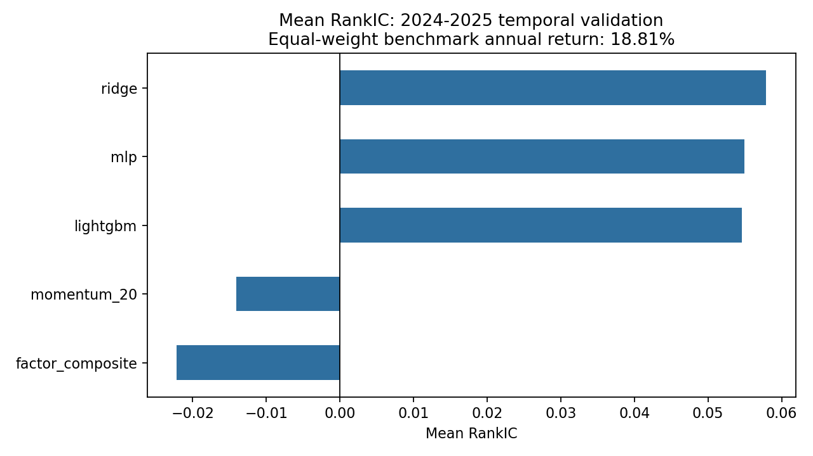
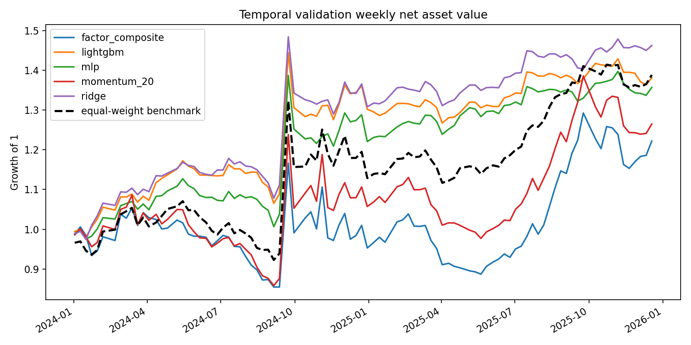

# A股横截面收益预测：MLP与线性基准的时间外比较

这是一个可复现的A股量化研究项目，包含两个共享同一套数据、标签、切分和组合评价逻辑的实验：

1. `momentum_factor`：5、10、20、60日价格动量的RankIC、五分组和多头组合。
2. `ml_cross_section`：动量、等权因子复合、Ridge、MLP与LightGBM的横截面收益预测对比。

项目当前状态为**历史名单五日网格上的研究原型**。数据已覆盖历史名单并集481只股票，但仍不是逐日成分股或可执行交易系统。

## 核心结果

时间外验证期为2024-01至2025-12，股票池为信号日历史名单、可交易、非ST和流动性过滤后的股票。该区间未参与参数选择，但已用于项目报告，因此不称为完全盲测。

| 实验 | Mean RankIC | ICIR（未年化） | Top20%年化 | Sharpe | 最大回撤 |
|---|---:|---:|---:|---:|---:|
| 20日动量 | -0.0140 | -0.0652 | 13.13% | 0.490 | -21.11% |
| MLP | 0.0549 | **0.2794** | 17.39% | 0.698 | -12.83% |
| Ridge | **0.0579** | 0.2261 | **22.09%** | **0.845** | -13.09% |
| LightGBM | 0.0546 | 0.2380 | 18.49% | 0.745 | -12.29% |





组合评价使用10bps单边成交额成本，每5个市场交易日调仓，Top20%等权。相同股票池等权基准在时间外验证期年化为18.81%。因此：

- MLP取得了正时间外验证RankIC，ICIR为0.2794，在三个学习模型中最高；但Mean RankIC和年化收益仍低于Ridge。
- MLP的Sharpe高于等权基准，但年化收益低约1.42个百分点，不能声称它已经形成稳定alpha。
- 只有Ridge在10bps成本下取得正超额收益，LightGBM和MLP仍未跑赢等权基准。
- 20日动量在新历史股票池和开盘到开盘标签下仍为负RankIC，未发现稳定正向动量。
- 剔除2024-09-23和2024-09-30两个事后识别的高波动周期后，MLP年化收益降至6.49%，Sharpe降至0.617，收益高度依赖少数极端行情。

完整结果见 [ML实验报告](outputs/ml_cross_section/report.md) 和 [动量实验报告](outputs/momentum/report.md)。

与原动量项目的同步范围和未同步的交易细节见 [同步说明](docs/SYNC_WITH_SOURCE_PROJECT.md)。

## 研究设计

- 信号：t日收盘后计算特征。
- 持有：t+1开盘进入，t+6开盘退出。
- 标签：`open[t+6] / open[t+1] - 1`。
- 开发期：2020年预热后至2022年末。
- 验证期：2023年。
- 时间外验证期：2024-2025年。
- 训练边界：训练标签结束日必须早于验证期；不使用随机打散日期。
- 特征：15个价格与价格区间特征，在每个信号日按可选股票池转成横截面百分位。
- 模型：Ridge、两层MLP、LightGBM、20日动量和等权因子复合。
- 调参：Ridge仅用验证期选择alpha；LightGBM仅用验证期决定轮数；MLP超参数固定，三随机种子平均。
- 组合：剔除最后一个未来收益完全缺失的未完成持有期；换手使用收益漂移后的调仓前权重。

## 数据边界

本地行情共731,507行、481只历史成员股票、2019-07-01至2025-12-31。研究截面使用2020-2025年的291个历史名单查询日。

因此当前实现已经避免只用当前300只成分股回溯，并加入信号日可交易、非ST、120个可交易日和20日平均成交额过滤。历史成员仍按五日研究网格取样，不是逐日重建；组合评价也没有模拟涨跌停阻塞后的持仓延期、成交容量和逐日现金账本。

股票池、日期、特征和回测公式的详细说明见 [方法与数据限制](docs/METHODOLOGY.md)。

## 复现

已验证环境为Windows x64、Python 3.13.9。安装依赖：

```powershell
python -m venv .venv
.\.venv\Scripts\python.exe -m pip install -r requirements.txt
```

如果本地缺少历史行情文件，先从Baostock拉取并冻结数据：

```powershell
.\.venv\Scripts\python.exe scripts\build_historical_dataset.py --workers 4
```

下载器会生成481只历史成员行情、291个历史名单快照和数据SHA-256清单。详细说明见[数据获取](docs/DATA_ACQUISITION.md)。如果行情文件不存在，真实数据集成测试会自动跳过；合成数据上的时间、特征和交易成本测试仍会运行。

运行测试和两个研究：

```powershell
.\.venv\Scripts\python.exe -m unittest discover -s tests -v
.\.venv\Scripts\python.exe -m src.research.momentum_factor
.\.venv\Scripts\python.exe -m src.research.ml_cross_section
```

也可以使用 `run_all.ps1`：

```powershell
.\run_all.ps1
```

项目使用本地 `.venv` 运行，依赖版本记录在 `requirements.txt`。

## 目录

```text
config.json                 固定实验配置
src/common/data.py           行情读取、核验和历史名单时点过滤
src/common/features.py       特征、未来收益标签、横截面处理和时间切分
src/common/models.py         Ridge、MLP、LightGBM训练和对照
src/common/evaluation.py     RankIC、组合、换手、成本和绩效指标
src/research/                两个可执行研究
tests/                       时间、数据、成本与评价单元测试
outputs/                     指标、预测、净值、图和报告
figures/                     README与简历展示图
docs/                        方法、数据限制和实验记录
```

## 已知限制

- 历史成员按五日研究网格取样，不是逐日成分股快照。
- 后复权口径由Baostock记录，但未独立复核全部公司行为。
- 主实验不使用成交量类特征；成交额只用于流动性过滤。
- 信号日已过滤停牌和ST；组合评价仍未模型化下一日无法买入、到期无法卖出后的持仓延期。
- 组合是周频解析回测，不维护逐日现金和股数账本。
- 时间外验证结果已经用于项目报告，不再视为完全盲测。

